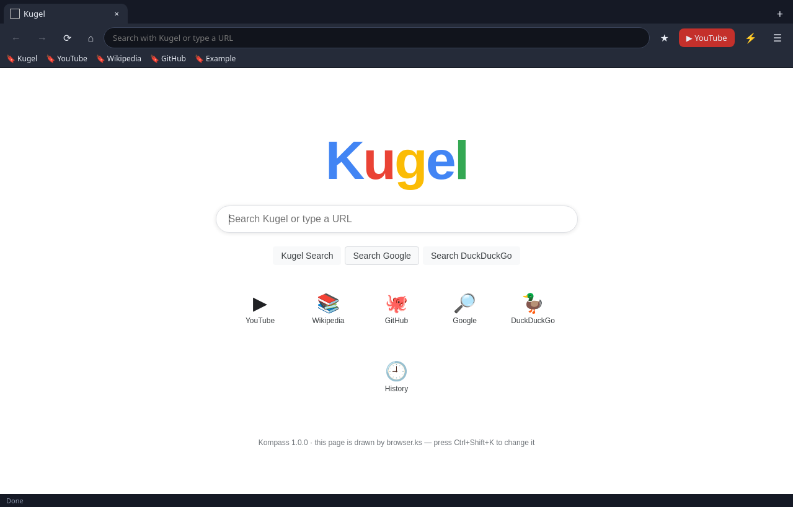
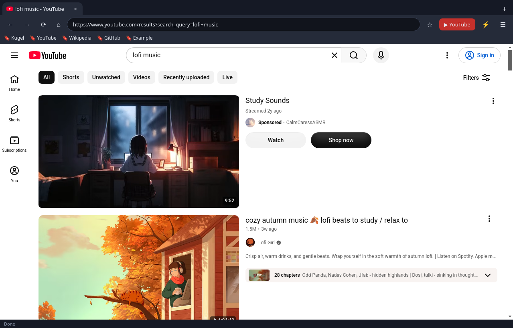

# 🧭 Kompass — a Windows browser written in KampfScript

Kompass is a real desktop web browser for Windows whose **entire interface and logic are a program written in KampfScript** (`.ks`), the tiny custom language from [KampfOS](https://github.com/KampfGuy/kampfos).
Electron/Chromium only renders web pages and provides native built-ins; tabs, the address bar, bookmarks, history, the **Kugel** start page and search, settings and keyboard shortcuts all live in [`resources/browser.ks`](resources/browser.ks) — which you can edit from inside the app.




## Download & run (Windows 10/11 x64)
Get it from **[Releases](https://github.com/KampfGuy/kompass/releases/latest)**:
- `Kompass-1.0.0-portable.exe` — single file, no install. Double-click it.
- `Kompass-1.0.0-win-x64.zip` — unzip anywhere, run `Kompass.exe`.

The exe is **not code-signed**, so Windows SmartScreen will say "Windows protected your PC". Click **More info → Run anyway**.

## Features
- Real Chromium rendering in sandboxed `<webview>`s — normal sites and **YouTube** work (▶ YouTube button, `Ctrl+Y`)
- Tabs (`Ctrl+T`, `Ctrl+W`, `Ctrl+Tab`, middle-click to close), back/forward/reload/home
- Address bar takes URLs **or** search terms → **Kugel** (default), Google or DuckDuckGo (set in ☰ settings)
- Kugel start page + results page drawn by KampfScript (results from the KampfOS search worker)
- Bookmarks bar (☆ / `Ctrl+D`), history (`Ctrl+H`), all saved as JSON files in your profile
- Simple ad/tracker blocklist (`resources/ks/blocklist.txt`), toggle in settings
- **⚡ KampfScript editor & console** (`Ctrl+Shift+K` or the ⚡ button): write and run your own `.ks` scripts, or edit `browser.ks` and hit **Save & restart browser**

Your data (settings, bookmarks, history, your copy of `browser.ks`, `scripts/`) is in `%APPDATA%\Kompass\kompass\`. "Reset browser.ks" in the editor restores the original.

## KampfScript in 30 seconds
```ks
# variables, lists, maps
let name = "Kampf"
let sites = [{title: "YouTube", url: "https://www.youtube.com/"}]
push(sites, {title: "Wiki", url: "https://en.wikipedia.org/"})

# functions, loops, if/else
fn greet(who) { return "Hello, " + who + "!" }
for s in sites { print(s.title, "->", s.url) }
if len(sites) > 1 { print(greet(name)) } else { print("lonely") }

# UI + browser built-ins (in the console, open_tab opens a tab)
let r = row(body())
button(r, "Open YouTube", fn() { open_tab("https://www.youtube.com") })
```
Syntax: `let`, `fn`, `return`, `if / else`, `while`, `for x in list`, `break`, `continue`, `and / or / not`, `true / false / nil`, `#` comments. Use new lines or `;` between statements.

A taste of `browser.ks`:
```ks
fn go(input_text) {
  if current == nil { new_tab(input_text); return }
  tab_navigate(current, fix_url(input_text))
}

on_tab_event(fn(ev, id, value) {
  if ev == "popup" { new_tab(value); return }
  let t = tabs[str(id)]
  if ev == "title" { t.title = value; settext(t.text, value) }
  else if ev == "visit" { add_history(value, t.title) }
  else if ev == "internal" { render_internal(id, value) }
  if id == current { refresh_toolbar() }
})
```

### Native built-ins
| group | functions |
|---|---|
| UI | `body() box row col label heading button link textbox image settext gettext settip setimage clear destroy addstyle removestyle togglestyle show enable focus on_click on_middle_click on_key set_window_title after every` |
| tabs | `view_area tab_new tab_navigate tab_select tab_close tab_back tab_forward tab_reload tab_stop tab_url tab_title tab_can_back tab_can_forward tab_page tab_zoom tab_find tab_mute tab_devtools on_tab_event` (events: `title url loading visit favicon error internal popup state`) |
| services | `load_data save_data kugel_search url_encode url_decode now_text adblock open_external open_editor open_data_folder reload_app quit` |
| core | `print len str num type range push pop insert remove keys values has contains indexof upper lower trim split join replace startswith endswith slice sort reverse map filter min max round random time sleep …` |

## Build from source
```bash
npm install
npm start                                   # run (Linux/macOS/Windows)
npm test                                    # interpreter + browser.ks tests
npx electron-builder --win portable --x64   # Windows portable exe
```

## Security
Main window: `contextIsolation: true`, `nodeIntegration: false`, `sandbox: true`, strict CSP, a minimal preload bridge. Every web page runs in a `<webview>` forced to `sandbox: true`, `nodeIntegration: false`, `contextIsolation: true`, no preload (enforced in `will-attach-webview`). KampfScript is interpreted, no `eval`.

## Limitations
- Unsigned exe (SmartScreen warning); no custom exe icon embedded (built on Linux without wine).
- Built and tested on Linux (Xvfb); not yet tried on a real Windows machine.
- YouTube: browsing/searching works; some videos may need DRM (Widevine) which plain Electron lacks, and Google sign-in may refuse embedded browsers.
- Kugel results come from a small free search worker; use Google/DuckDuckGo for heavy searching.

MIT licensed.
