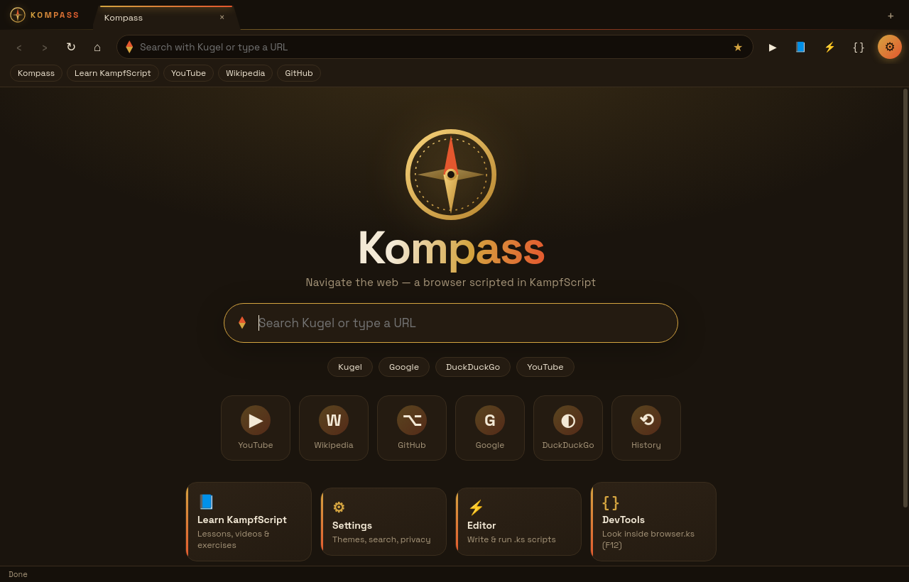

# 🧭 Kompass

This repository has two apps, both built with **KampfScript** (`.ks`), the small language from
[KampfOS](https://github.com/KampfGuy/kampfos):

- **[Kompass for Windows](#-kompass-for-windows)**, a desktop web browser
- **[Kompass VR](#-kompass-vr-for-meta-quest)**, the same browser as an app for Meta Quest headsets

---

## 🧭 Kompass for Windows

### ⬇ Download
**[Download the latest Kompass for Windows](https://github.com/KampfGuy/kompass/releases/latest)**
(Windows 10/11, 64-bit). It comes in two forms:
- `Kompass-<version>-portable.exe`: a single file with no install. Double-click it to run. **This is the one that updates itself.**
- `Kompass-<version>-win-x64.zip`: unzip it anywhere and run `Kompass.exe`.

The exe isn't code-signed, so Windows SmartScreen will say "Windows protected your PC". Click **More info → Run anyway**.

### What it is
Kompass is a real Chromium-based web browser for Windows. Its whole interface is a KampfScript program,
[`resources/browser.ks`](resources/browser.ks), which you can read and edit from inside the app: tabs, address bar,
bookmarks, history, settings, the start page and every `kompass://` page. Electron (Chromium 156) only draws web pages
and provides native built-ins.



### What it can do
- **Browse the real web.** Each page runs in a sandboxed Chromium tab, so YouTube, Google, Docs and the rest work.
  - It has tabs, back/forward, bookmarks bar (`Ctrl+D`), history (`Ctrl+H`), find, zoom and an ad/tracker blocklist.
  - You can type a search into the address bar and it goes to **Kugel**, Google or DuckDuckGo.
  - Since 1.6.0, Google sees a normal, up-to-date browser. Google sign-in is still hit-and-miss (see below).
- **Fullscreen.** Use `F11` for the whole browser, or the ⛶ fullscreen button on a page (YouTube, Slides, Maps…). `Esc` leaves fullscreen.
- **Kugel Store** (`kompass://store`): a catalog of KampfScript games and apps, including 3D games, that run in a sandbox. You can **publish your own** from the editor.
- **3D games API.** Over 40 built-ins on three.js: `scene3d`, `cube`, `sphere`, `move3d`, `camera3d`, `fps_controls`, `hits3d`, `ray3d`, `gamepad()`…
  - The `vr_*` built-ins also work on a normal screen (mouse = hand).
  - Try them at `kompass://games3d`, `kompass://maze3d` and `kompass://runner3d`.
- **Learn KampfScript** (`kompass://learn`, `F1`): 15 lessons with runnable examples, auto-checked exercises, saved progress and tutorial videos. Lessons ⑫–⑮ teach making 3D games. `kompass://learn/ai` is the full language reference to paste into an AI.
- **⚡ Editor and console** (`Ctrl+Shift+K`): write and run your own `.ks` scripts, make your own `kompass://page/...` pages, or edit `browser.ks` and restart.
  - The **builder** (`kompass://builder`) makes a custom Google-style home page.
- **{ } KampfScript DevTools** (`F12`): an inspector, a live console (REPL), an event log, a debugger with breakpoints and stepping, a source/AST view, performance and errors. Chromium's page devtools are there too.
- **🔑 Password manager**: an encrypted vault, a "save password?" bar, autofill, CSV and encrypted import/export. KampfScript code never sees a password.
- **Looks**: four themes (Brass, Midnight, Neon, Paper), an accent colour and a double right-click quick menu.

Your data (settings, bookmarks, history, scripts, your `browser.ks`) lives in `%APPDATA%\Kompass\kompass\`.

### How it updates
- **When it checks:** the portable exe checks **GitHub's latest release** (`/releases/latest`) when it starts and every 4 hours.
- **How it updates:** when there's a newer version, Kompass reads that release's `kompass-update.json` and downloads the new exe in the background.
  - It **checks the size and SHA512**, then shows **"Update ready — restart to update"**.
  - Restart Kompass (or just close it) and the new exe replaces the old one. It's the same file and your data stays.
- **Prereleases are never offered.** GitHub's "latest" never points to a prerelease, so the VR builds below never reach Windows.
- **The zip build** can't replace itself, so it shows "new version available → Download".
- **Settings → Updates** has an Auto-update switch, a Check now button and your current version.

### What's new in 1.6.0
- **Google sees an up-to-date browser.** Kompass 1.5 ran **Chromium 130** (late 2024) while Chrome is at 159, and its
  pages went out without Chrome's client hints. Kompass now runs **Electron 45 / Chromium 156** and sends a clean Chrome
  User-Agent with the real version plus `Sec-CH-UA` on every site.
- **Google sign-in: better, but not guaranteed.** Google deliberately blocks sign-in in browsers built into apps
  ("Couldn't sign you in — This browser or app may not be secure"), and it spots Electron even when it claims to be Chrome.
  Kompass now uses a Firefox User-Agent on Google's sign-in pages (`accounts.google.com`) only, which sometimes gets you
  to the password step. If Google still refuses, a note explains what happened and offers **↗ Open in my browser**.
- **The Kompass VR app's source is now in this repo**, in `android/` and `vr/`.

### Build from source
```bash
npm install
npm start                 # run
npm test                  # interpreter, browser.ks, lessons, 3D games, user-agent tests
node tools/release.js     # build portable exe + zip + kompass-update.json + SHA512SUMS and publish (docs/RELEASING.md)
```

---

## 🥽 Kompass VR (for Meta Quest)

### ⬇ Download
**[Download Kompass VR 1.6.0-vr.1 (APK)](https://github.com/KampfGuy/kompass/releases/download/v1.6.0-vr.1/Kompass-VR-1.6.0-vr.1.apk)**.
You can also see [all Kompass VR releases](https://github.com/KampfGuy/kompass/releases?q=Kompass+VR&expanded=true) and pick the newest `Kompass-VR-<version>.apk`.
VR builds are published as GitHub *prereleases*, so they never show up as the Windows "latest".

### What it is
Kompass VR is the same KampfScript browser (`browser.ks` plus a VR add-on), packaged as an Android app that runs as a
2D panel on Meta Quest. It's built for headset use:
- big touch targets
- point-and-trigger clicking
- hold the trigger (or pinch) for the quick menu
- an on-screen keyboard
- controller B goes Back

### What it can do
- **Browse the web** in tabs, with bookmarks, history, Kugel/Google search, the editor, Learn (16 lessons, including ⑯ *VR games*) and the password vault.
- **3D and VR mode.** The full 3D API, plus `vr_setup`, `vr_start`, `vr_hand` (position, swing speed, trigger/grip/A/B/stick), `vr_attach`, `vr_haptic`, `panel3d`…
  - Quest's in-app web view has no WebXR, so **"Play in VR"** opens the game in the **Quest Browser**. Press *Enter VR* there for real immersive VR. The app serves its own files from `127.0.0.1` for this.
- **A VR-only Kugel Store** (`index-vr.json`) with three VR games:
  - 🎾 **Kugel Tennis VR**: Wii-Tennis for VR. Swing your controller like a racket against a CPU, with real tennis scoring.
  - 🦍 **Kugel Gorillas VR**: Gorilla-Tag-style arm locomotion. Push off the ground, rocks and trees to run and climb, and tag 4 AI gorillas.
  - ⚔ **Kugel Saber VR**: Beat-Saber style. Slice red and blue blocks in the arrow's direction, dodge bombs, and build combos up to 8×.

### How to install (sideload)
1. Turn on **Developer mode** for your headset in the Meta Horizon phone app. It needs a free Meta developer account.
2. Connect the Quest to your PC with USB and allow USB debugging.
3. Install the app with `adb install -r Kompass-VR-<version>.apk` (Android platform-tools), or drag the APK onto **SideQuest**.
4. On the Quest, open **App Library → Unknown Sources → Kompass VR**.

New versions install over old ones and keep your data, because every build is signed with the same key.

### How it updates
Kompass VR checks the **full GitHub release list, including prereleases**, for the newest release that has a
`Kompass-VR-*.apk`. When it finds a newer version it shows **"update available"** and opens the APK download.
Install that APK the same way you installed the app, and it goes over the old one.

### Build from source
```bash
node vr/build-web.js <out>   # the web bundle (also done by the Gradle build)
vr/build-apk.sh              # APK -> /workspace/kompass-vr-dist/Kompass-VR-<version>.apk (JDK 17, Android SDK 34, Gradle 8.7)
npm run test:vr              # VR bundle + VR API on a simulated WebXR runtime + bots playing the 3 VR games
```
There's more detail in [`vr/README.md`](vr/README.md).

---
MIT licensed.
