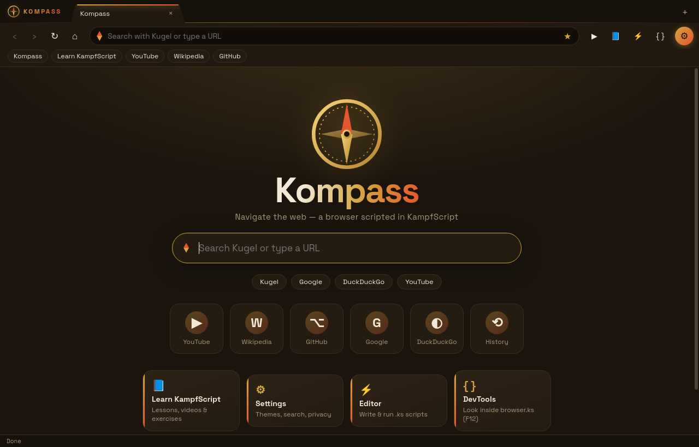
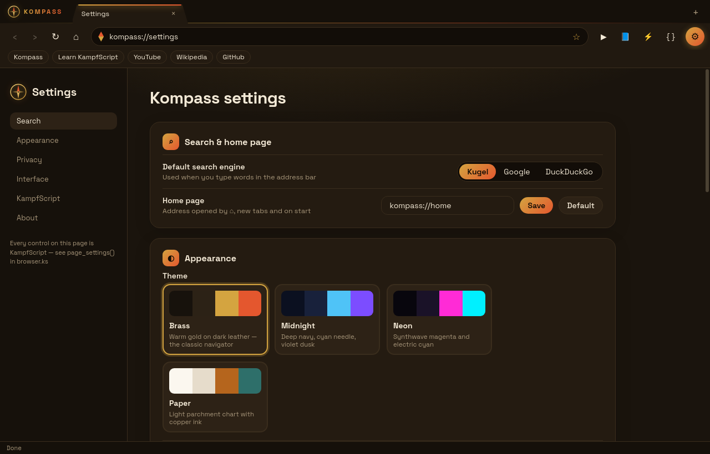
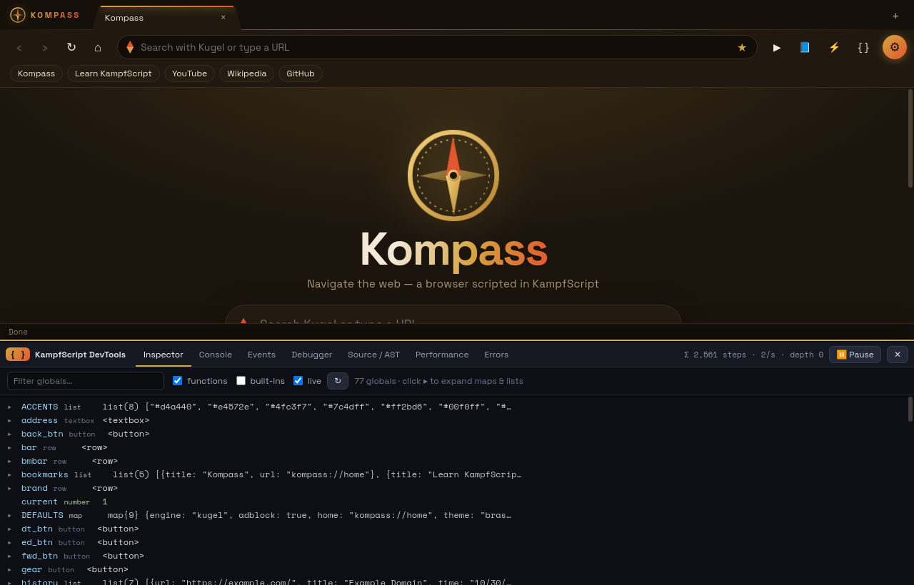
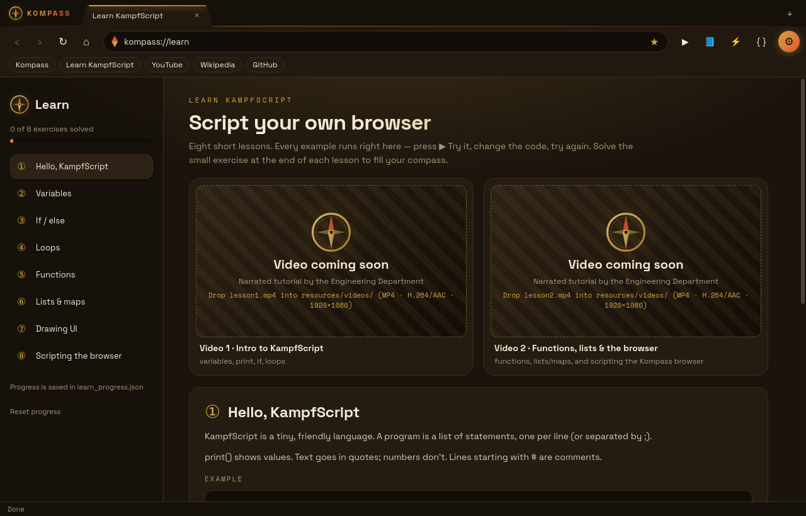

# 🧭 Kompass — a Windows browser written in KampfScript

Kompass is a real desktop web browser for Windows whose **entire interface and logic are a program written in KampfScript** (`.ks`), the tiny custom language from [KampfOS](https://github.com/KampfGuy/kampfos).
Electron/Chromium only renders web pages and provides native built-ins; tabs, the address bar, bookmarks, history, the **Kugel** start page and search, settings and keyboard shortcuts all live in [`resources/browser.ks`](resources/browser.ks) — which you can edit from inside the app.






## Download & run (Windows 10/11 x64)
Get it from **[Releases](https://github.com/KampfGuy/kompass/releases/latest)**:
- `Kompass-1.1.0-portable.exe` — single file, no install. Double-click it.
- `Kompass-1.1.0-win-x64.zip` — unzip anywhere, run `Kompass.exe`.

The exe is **not code-signed**, so Windows SmartScreen will say "Windows protected your PC". Click **More info → Run anyway**.

## What's new in 1.1
- **⚙ Settings button** in the toolbar → `kompass://settings` (drawn by KampfScript): search engine, home page, themes + accent colour, ad/tracker blocklist, bookmarks bar, clear history / all browsing data, reset browser.ks, DevTools toggle, tutorial video URLs, about.
- **A look of its own**: compass logo & needle motif, slanted "chart-card" tabs with an accent glow, gradient accents, bundled fonts (Space Grotesk + Space Mono, SIL OFL, in `src/fonts/`), new start page, and four themes — **Brass** (default), **Midnight**, **Neon**, **Paper**.
- **{ } KampfScript DevTools** (`F12` / `Ctrl+Shift+I`, or the `{ }` button) — see below.
- **📘 Learn KampfScript** (`kompass://learn`, `F1`): 8 lessons with runnable, editable examples, auto-checked exercises, saved progress and two tutorial-video slots.
- Internal pages now use `kompass://` (old `kampf://` links still work). If you never edited your browser.ks it is upgraded automatically; if you did, your copy is kept — use Settings → *Reset browser.ks* to get the 1.1 interface.

## KampfScript DevTools
Separate from Chromium's devtools for web pages (those are `Ctrl+Shift+J` or Settings → *Page devtools*).
| panel | what it shows |
|---|---|
| **Inspector** | live tree of all browser.ks globals — expand maps, lists, functions and UI elements; filter; auto-refresh |
| **Console** | a REPL that runs in the *live* browser.ks environment (`tab_url(current)`, `settings.theme = "neon"; apply_look()`), ↑ history; also shows `print()` output |
| **Events** | every native call (`tab_navigate`, `settext`, `on_tab_event` …) with arguments and line, every engine event (`title`, `url`, `loading` …) and every callback with its step count; filter / freeze |
| **Debugger** | breakpoints (click a line number in Source, or type one), ⏸ Pause at next statement, ▶ Resume (`F8`), ⤵ Step (`F10`), call stack, local scopes, step counters |
| **Source / AST** | browser.ks, your scripts or pasted code as numbered source, a token view and a collapsible AST |
| **Performance** | steps / calls / avg / max / ms per event handler |
| **Errors** | every KampfScript error with its line — click to jump to that line in the editor |

Interpreter hooks added for this (in `src/lang.js`, all optional): `hooks.statement(stmt, env)` (may return a promise to pause), `hooks.builtin(name, args, line)`, `hooks.invoke(label, steps, ms, error)`, `interp.callStack`, `interp.repl(src)`.

## Learn KampfScript & tutorial videos
`kompass://learn` (linked from the start page, Settings, the toolbar 📘 button and the ⚡ editor) has lessons: Hello · Variables · If/else · Loops · Functions · Lists & maps · Drawing UI · Scripting the browser. **▶ Try it** runs the code box in a sandboxed interpreter (core built-ins only; the UI lesson gets a small stage; `open_tab` only prints). Exercises check your printed output; progress is saved in `learn_progress.json`.

### Where to put the two videos
| slot | file name | suggested topic |
|---|---|---|
| Video 1 | `lesson1.mp4` | *Intro to KampfScript: variables, print, if, loops* |
| Video 2 | `lesson2.mp4` | *Functions, lists/maps, and scripting the Kompass browser* |

**Format:** MP4 container, **H.264 (AVC) video + AAC audio**, suggested **1920×1080** (1280×720 fine), 30 fps, `yuv420p`, `+faststart`. e.g. `ffmpeg -i in.mov -c:v libx264 -pix_fmt yuv420p -crf 20 -c:a aac -b:a 160k -movflags +faststart lesson1.mp4`

Kompass uses the first file it finds in:
1. `resources/videos/` in this repo (→ bundled into the next build at `resources\ks\videos\`); in an unzipped build: `Kompass-1.1.0-win-x64\resources\ks\videos\lesson1.mp4`
2. `%APPDATA%\Kompass\kompass\videos\lesson1.mp4` (works with the portable exe too)
3. a `videos\` folder next to `Kompass-1.1.0-portable.exe`

…otherwise the URL set in Settings → KampfScript → *Tutorial video URLs* (https://…mp4), otherwise a "Video coming soon" placeholder.

## Features
- Real Chromium rendering in sandboxed `<webview>`s — normal sites and **YouTube** work (▶ YouTube button, `Ctrl+Y`)
- Tabs (`Ctrl+T`, `Ctrl+W`, `Ctrl+Tab`, middle-click to close), back/forward/reload/home
- Address bar takes URLs **or** search terms → **Kugel** (default), Google or DuckDuckGo (set in ⚙ settings)
- Kugel start page + results page drawn by KampfScript (results from the KampfOS search worker)
- Bookmarks bar (☆ / `Ctrl+D`), history (`Ctrl+H`), all saved as JSON files in your profile
- Simple ad/tracker blocklist (`resources/ks/blocklist.txt`), toggle in settings
- **⚡ KampfScript editor & console** (`Ctrl+Shift+K` or the ⚡ button): write and run your own `.ks` scripts, or edit `browser.ks` and hit **Save & restart browser**

Your data (settings, bookmarks, history, your copy of `browser.ks`, `scripts/`) is in `%APPDATA%\Kompass\kompass\`. "Reset browser.ks" in the editor restores the original.

## KampfScript in 30 seconds
```ks
# variables, lists, maps
let name = "Kampf"
let sites = [{title: "YouTube", url: "https://www.youtube.com/"}]
push(sites, {title: "Wiki", url: "https://en.wikipedia.org/"})

# functions, loops, if/else
fn greet(who) { return "Hello, " + who + "!" }
for s in sites { print(s.title, "->", s.url) }
if len(sites) > 1 { print(greet(name)) } else { print("lonely") }

# UI + browser built-ins (in the console, open_tab opens a tab)
let r = row(body())
button(r, "Open YouTube", fn() { open_tab("https://www.youtube.com") })
```
Syntax: `let`, `fn`, `return`, `if / else`, `while`, `for x in list`, `break`, `continue`, `and / or / not`, `true / false / nil`, `#` comments. Use new lines or `;` between statements.

A taste of `browser.ks`:
```ks
fn go(input_text) {
  if current == nil { new_tab(input_text); return }
  tab_navigate(current, fix_url(input_text))
}

on_tab_event(fn(ev, id, value) {
  if ev == "popup" { new_tab(value); return }
  let t = tabs[str(id)]
  if ev == "title" { t.title = value; settext(t.text, value) }
  else if ev == "visit" { add_history(value, t.title) }
  else if ev == "internal" { render_internal(id, value) }
  if id == current { refresh_toolbar() }
})
```

### Native built-ins
| group | functions |
|---|---|
| UI | `body() box row col label heading button link textbox codebox video image setcolor set_theme set_accent themes confirm settext gettext settip setimage clear destroy addstyle removestyle togglestyle show enable focus on_click on_middle_click on_key set_window_title after every` |
| tabs | `view_area tab_new tab_navigate tab_select tab_close tab_back tab_forward tab_reload tab_stop tab_url tab_title tab_can_back tab_can_forward tab_page tab_zoom tab_find tab_mute tab_devtools on_tab_event` (events: `title url loading visit favicon error internal popup state`) |
| services | `load_data save_data kugel_search url_encode url_decode now_text adblock open_external open_editor open_data_folder reload_app quit app_version clear_browsing_data reset_browser ks_devtools run_sandbox video_file videos_folder open_videos_folder` |
| core | `print len str num type range push pop insert remove keys values has contains indexof upper lower trim split join replace startswith endswith slice sort reverse map filter min max round random time sleep …` |

## Build from source
```bash
npm install
npm start                                   # run (Linux/macOS/Windows)
npm test                                    # interpreter (+debug hooks) + browser.ks + lessons tests
KOMPASS_SHOTS=/tmp/shots npm start          # screenshot self-test of the 1.1 pages
npx electron-builder --win portable --x64   # Windows portable exe
```

## Security
Main window: `contextIsolation: true`, `nodeIntegration: false`, `sandbox: true`, strict CSP, a minimal preload bridge. Every web page runs in a `<webview>` forced to `sandbox: true`, `nodeIntegration: false`, `contextIsolation: true`, no preload (enforced in `will-attach-webview`). KampfScript is interpreted, no `eval`.

## Limitations
- Unsigned exe (SmartScreen warning); no custom exe icon embedded (built on Linux without wine).
- Built and tested on Linux (Xvfb); not yet tried on a real Windows machine.
- YouTube: browsing/searching works; some videos may need DRM (Widevine) which plain Electron lacks, and Google sign-in may refuse embedded browsers.
- Kugel results come from a small free search worker; use Google/DuckDuckGo for heavy searching.

MIT licensed.

## What's new in 1.2.0

- **Tutorial videos bundled**: `kompass://learn` plays `lesson1.mp4` (4:50) and `lesson2.mp4` (4:07) from `resources/videos/` with no setup.
- **G — Make Google page with KS** (`kompass://builder`, toolbar **G**, start page, Learn, Ctrl+G): build your own Google-style home page in KampfScript with a live split view (code ↔ preview), 4 templates, multiple saved pages, and **⌂ Set as my home page** / **↺ Restore default**. The page's search box really searches (Kugel / Google / DuckDuckGo from Settings); "I'm Feeling Lucky" jumps to the top result. New safe styling built-ins: `setstyle`, `setfont`, `setsize`, `gradient`, `colorletters`, `spacer`, `on_input`, `fonts`, `css_props`, `popup`. New Learn lesson ⑨.
- **For AIs** (`kompass://learn/ai`, also [docs/KAMPFSCRIPT_FOR_AI.md](docs/KAMPFSCRIPT_FOR_AI.md)): one complete, copy-friendly KampfScript reference, generated from the real interpreter/host by `node tools/gen-ai-doc.js` (tests fail if any built-in is undocumented). Copy all / Save as .md / .txt.
- **Password manager** (`kompass://passwords`, Ctrl+Shift+P): local vault `vault.kpv` (scrypt + AES-256-GCM, master password, auto-lock after 5 min), "Save password?" bar on login, autofill offer on matching sites, reveal/copy/edit/delete/search, strong password generator, CSV and encrypted (.kpx) import/export. KampfScript never receives passwords (opaque `pw_input` / `pw_reveal` handles).
- **Double right-click** anywhere: KampfScript quick menu (back, forward, reload, new/close tab, bookmark, copy URL, DevTools, settings, Learn, passwords). Single right-click: native context menu (back/forward/reload, copy/paste, open link in new tab, inspect). Hook: `on_double_right_click(fn(x, y, on_web, link))`.
- Standard Chrome user agent for all pages. Google sign-in may still be refused ("This browser or app may not be secure"); Kompass then shows a note.
